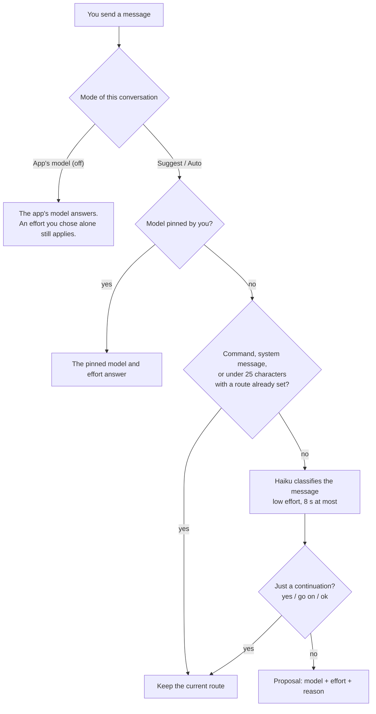
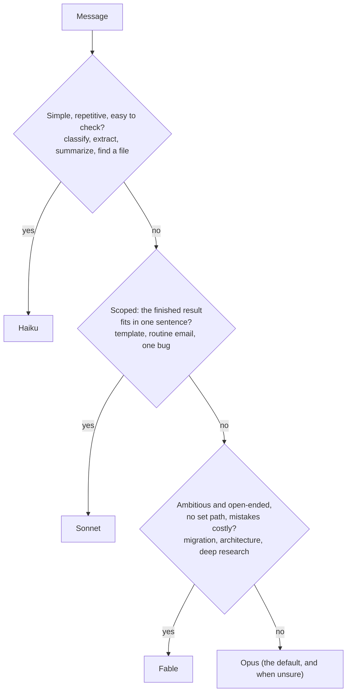
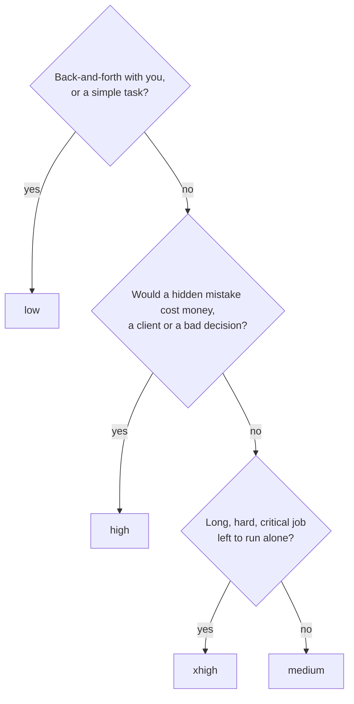
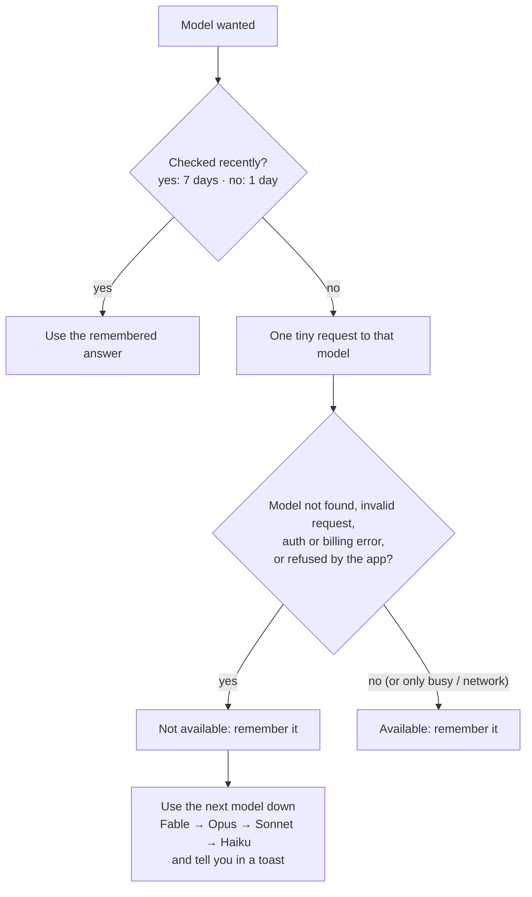
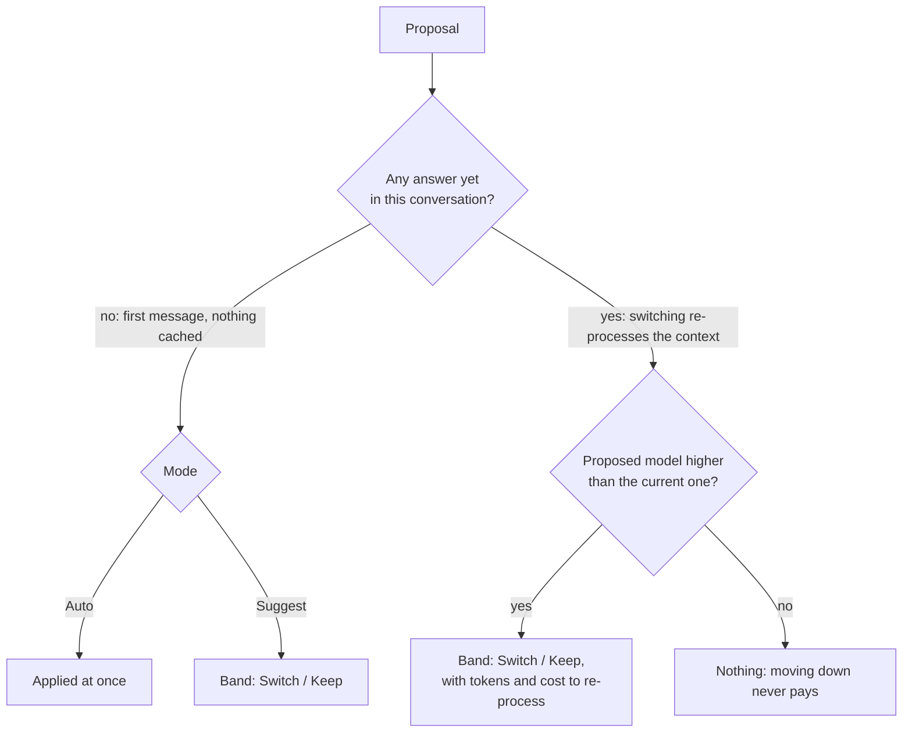
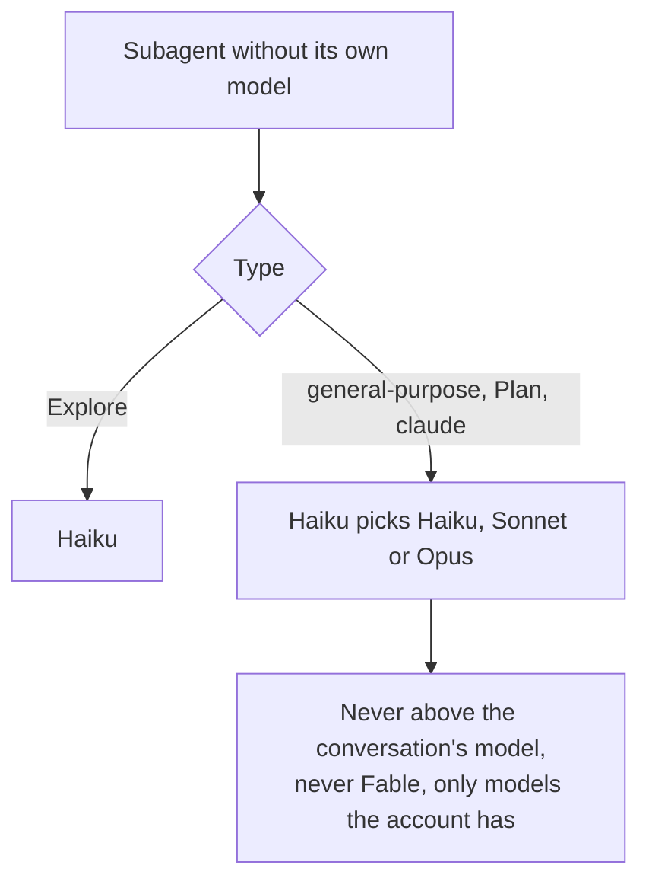

# How model-router picks the model and the effort

*Español más abajo · [Deutsch](#deutsch) · [Français](#français)*

Everything here applies to **one conversation**. Each conversation keeps its own mode, its own pinned model and its own effort.

## 1. Does the router act at all?

## 2. Which model Haiku proposes

## 3. Which effort Haiku proposes

Stop at the first *yes*.

`max` is never proposed: it costs a lot for very little.

## 4. Is the model available on your account?

Not every account can use every model (Fable in particular). Claude Code gives a mod no list of the plan's models, so the router asks once:

Haiku is always taken as available: the router itself runs on it.

## 5. When the proposal is applied

Mid-conversation the router never switches on its own, not even in Auto.

## 6. What you set by hand

| Action | Effect |
| --- | --- |
| Pin *model* (menu or `/modelo opus high`) | That model answers from now on; the router stops proposing. If the mode was off it becomes Suggest. If the account lacks the model, the next one down is pinned. |
| Effort (menu or `/modelo high`) with a model pinned or chosen by the router | Changes only the effort; same model, so nothing is re-processed. |
| Effort with no model chosen | Pins nothing: the effort applies to whatever model the app picks. |
| `/modelo libre` | Drops the pinned model and the effort; the app decides again. |

## 7. Subagents (Auto only)

A subagent starts with its own empty context, so picking a cheaper model costs nothing to re-process.

---

## Español

Todo vale para **una conversación**: cada una guarda su modo, su modelo fijado y su esfuerzo.

1. **¿Actúa el enrutador?** En *Modelo de la app* no toca nada (salvo un esfuerzo que hayas elegido tú). En *Sugerir* o *Auto*, si no has fijado modelo, Haiku clasifica cada mensaje; se salta comandos, mensajes del sistema, los de menos de 25 caracteres si ya hay ruta y las continuaciones («sí», «hazlo»).
2. **Modelo:** simple y fácil de comprobar → Haiku; acotado, el resultado cabe en una frase → Sonnet; ambicioso, abierto y caro si falla → Fable; en otro caso o si hay duda → Opus.
3. **Esfuerzo** (el primer «sí»): ida y vuelta o tarea simple → low; un error escondido costaría dinero o una mala decisión → high; trabajo largo y crítico que va solo → xhigh; si no → medium. Nunca max.
4. **¿Lo tiene tu cuenta?** Se prueba cada modelo una vez con una petición mínima y se recuerda (7 días si sí, 1 día si no). Si no está, se usa el siguiente hacia abajo (Fable → Opus → Sonnet → Haiku) y se avisa.
5. **Cuándo se aplica:** en el primer mensaje, Auto lo aplica y Sugerir pregunta. Con la conversación en marcha nunca cambia solo: solo sugiere subir, con el coste de reprocesar; bajar nunca.
6. **A mano:** fijar modelo lo deja fijo; el esfuerzo con modelo elegido cambia solo el esfuerzo; el esfuerzo sin modelo no fija nada y se aplica al de la app; `/modelo libre` lo suelta todo.
7. **Subagentes (solo Auto):** Explore → Haiku; los genéricos los elige Haiku entre Haiku, Sonnet y Opus, nunca por encima del de la conversación ni Fable.

## Deutsch

Alles gilt für **eine Unterhaltung**: jede merkt sich Modus, fixiertes Modell und Aufwand.

1. **Greift der Router ein?** Bei *Modell der App* nicht (außer einem selbst gewählten Aufwand). Bei *Vorschlagen* oder *Auto* ohne fixiertes Modell stuft Haiku jede Nachricht ein; ausgenommen Befehle, Systemnachrichten, Nachrichten unter 25 Zeichen bei bestehender Route und Fortsetzungen („ja“, „mach“).
2. **Modell:** einfach und leicht prüfbar → Haiku; eng umrissen, Ergebnis in einem Satz → Sonnet; ehrgeizig, offen, Fehler teuer → Fable; sonst oder im Zweifel → Opus.
3. **Aufwand** (erstes „ja“): Hin und Her oder einfach → low; ein versteckter Fehler kostet Geld oder eine Fehlentscheidung → high; lange, kritische Arbeit allein → xhigh; sonst → medium. Nie max.
4. **Hat dein Konto das Modell?** Jedes Modell wird einmal mit einer Mini-Anfrage geprüft und gemerkt (7 Tage ja, 1 Tag nein). Fehlt es, gilt das nächste darunter (Fable → Opus → Sonnet → Haiku), mit Hinweis.
5. **Wann es gilt:** bei der ersten Nachricht wendet Auto es an, Vorschlagen fragt. Später wechselt nichts von selbst: nur Vorschläge nach oben, mit den Kosten der Neuverarbeitung; nie nach unten.
6. **Von Hand:** Modell fixieren fixiert es; Aufwand bei gewähltem Modell ändert nur den Aufwand; Aufwand ohne Modell fixiert nichts und gilt für das Modell der App; `/modelo libre` gibt alles frei.
7. **Subagenten (nur Auto):** Explore → Haiku; die allgemeinen wählt Haiku zwischen Haiku, Sonnet und Opus, nie über dem Modell der Unterhaltung, nie Fable.

## Français

Tout vaut pour **une conversation** : chacune garde son mode, son modèle fixé et son effort.

1. **Le routeur agit-il ?** En *Modèle de l’app*, non (sauf un effort choisi par toi). En *Suggérer* ou *Auto*, sans modèle fixé, Haiku classe chaque message ; sauf commandes, messages système, messages de moins de 25 caractères quand une route existe et simples suites (« oui », « vas-y »).
2. **Modèle :** simple et facile à vérifier → Haiku ; cadré, résultat en une phrase → Sonnet ; ambitieux, ouvert, erreur coûteuse → Fable ; sinon ou en cas de doute → Opus.
3. **Effort** (premier « oui ») : allers-retours ou tâche simple → low ; une erreur cachée coûterait de l’argent ou une mauvaise décision → high ; long travail critique en autonomie → xhigh ; sinon → medium. Jamais max.
4. **Ton compte l’a-t-il ?** Chaque modèle est testé une fois par une requête minimale et retenu (7 jours si oui, 1 jour si non). S’il manque, on prend le suivant en dessous (Fable → Opus → Sonnet → Haiku), avec un avis.
5. **Quand c’est appliqué :** au premier message, Auto l’applique et Suggérer demande. Ensuite rien ne change seul : seulement des suggestions vers le haut, avec le coût du retraitement ; jamais vers le bas.
6. **À la main :** fixer un modèle le fixe ; l’effort avec un modèle choisi ne change que l’effort ; l’effort sans modèle ne fixe rien et s’applique au modèle de l’app ; `/modelo libre` libère tout.
7. **Sous-agents (Auto seulement) :** Explore → Haiku ; les génériques, Haiku choisit entre Haiku, Sonnet et Opus, jamais au-dessus du modèle de la conversation, jamais Fable.
