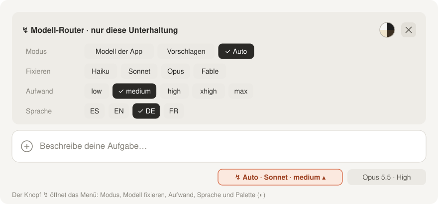
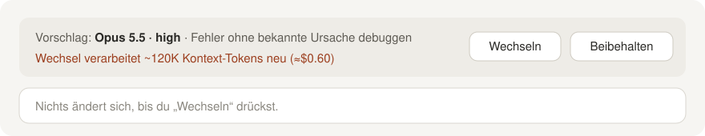
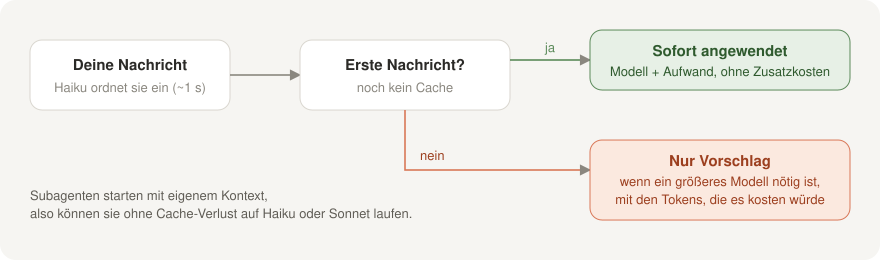

# model-router

[English](README.md) · [Español](README.es.md) · **Deutsch** · [Français](README.fr.md) · [Website](https://luispuertollano.github.io/claude-model-router/)

**Das passende Claude-Modell und der passende Aufwand für jede Unterhaltung, nach Anthropics Leitfaden, ohne deinen Kontext heimlich neu zu verarbeiten.**



Die meisten nutzen für alles dasselbe Modell und denselben Aufwand: Bei Einfachem zahlen sie zu viel, bei Schwierigem reicht es nicht. Dieses Plugin löst das:

- **Claude Code: ein Knopf `↯ Router ▾` neben der Modellauswahl.** Er öffnet ein Menü über dem Eingabefeld: *Modus* (Modell der App, *Vorschlagen*, *Auto*), Haiku, Sonnet, Opus oder Fable *fixieren*, *Aufwand* (low → max) und *Sprache* (ES, EN, DE, FR). Jede Unterhaltung merkt sich ihren Modus; neue starten aus.
- **Haiku ordnet deine Nachricht ein**, nach den Regeln von Anthropics [*Which Claude model should you build with?*](https://claude.dev/blog/which-claude-model-should-you-build-with/): Haiku für Einfaches und Wiederkehrendes, Sonnet für klar Umrissenes, Opus als Standard, Fable nur für ehrgeizige, offene Arbeit. Der Aufwand ergibt sich aus vier Fragen: Hin und her? `low` · Teurer Fehler? `high` · Lange kritische Arbeit? `xhigh` · sonst `medium`.
- **Keine versteckten Kosten.** Ein Modellwechsel mitten in der Unterhaltung verarbeitet den ganzen Kontext neu, weil der Cache zu jedem Modell gehört. Deshalb wechselt die Mod nur bei der **ersten Nachricht** von selbst. Danach **schlägt sie vor**, zeigt die Token-Kosten und ändert nichts, bis du *Wechseln* drückst.
- **Günstigere Subagenten.** In *Auto* läuft Explore auf Haiku, andere allgemeine Subagenten werden eingeordnet, nie über dem Modell der Unterhaltung.
- **Claude-Chat und Cowork: der Skill `model-advisor`.** Er sagt dir in einer Zeile, welches Modell und welcher Aufwand passen, und schreibt eine Übergabe für eine neue Unterhaltung, wenn ein Wechsel mittendrin teuer wäre. In Cowork übernimmt der Subagent `haiku-reader` das lange Lesen auf Haiku (experimentell: Coworks Dokumentation sagt noch nicht, ob das Modell des Subagenten beachtet wird).





## Installation

**Claude Code, Terminal:**

```
/plugin install model-router --marketplace LuisPuertollano/claude-model-router
```

Beantworte *Add marketplace?* mit `y`, wähle mit Enter den Bereich *user*, dann erscheint `Installed model-router. Plugin is now active.` Aus einer Shell:

```bash
claude plugin install model-router --marketplace LuisPuertollano/claude-model-router
```

**Desktop-App, Chat und Cowork:** Klicke auf **+** neben dem Eingabefeld → **Plugins** → **Add marketplace** mit `LuisPuertollano/claude-model-router` → **Add plugin**.

**Optional, damit der Berater in Chat und Cowork von selbst hilft**, füge das unter claude.ai → Einstellungen → Profil → persönliche Präferenzen ein:

```
Nutze zu Beginn jeder neuen Aufgabe den Skill model-advisor, um mir in einer Zeile zu sagen, welches Claude-Modell und welcher Aufwand passen. Würde ein Wechsel mitten in der Unterhaltung einen langen Kontext neu verarbeiten, schlage stattdessen eine neue Unterhaltung mit Übergabe vor.
```

## Bedienung (Claude Code)

| Steuerung | Wirkung (nur diese Unterhaltung) |
| --- | --- |
| Modus: *Modell der App* | Aus: es gilt das in der App gewählte Modell. |
| Modus: *Vorschlagen* | Zeigt den Vorschlag; nichts ändert sich ohne *Wechseln*. |
| Modus: *Auto* | Wählt bei der ersten Nachricht; danach nur Vorschläge nach oben, mit Kosten. |
| Fixieren: *Opus…* | Fixiert dieses Modell in dieser Unterhaltung. |
| Aufwand: *low … max* | Ändert den Aufwand; gleiches Modell, also keine Neuverarbeitung. |
| Sprache: *ES · EN · DE · FR* | Sprache der Mod (alle Unterhaltungen). |
| `/modelo opus high` | Fixiert Modell und Aufwand. |
| `/modelo libre` | Zurück zum Modell der App. |
| `/modelo idioma de` | Ändert die Sprache. |

Ein Punkt (•) auf dem Knopf zeigt einen offenen Vorschlag. Die Sprache der Mod richtet sich zunächst nach der Einstellung `language` von Claude Code.

## Kosten

Jede eingeordnete Nachricht kostet einen kurzen Aufruf von Haiku 5.5, Bruchteile eines Cents. Kurze Antworten („ja“, „mach“) werden nicht eingeordnet. Bei ausgeschaltetem Router gibt es keinen Aufruf.

## Grenzen

- Knopf und Menü gibt es nur in **Claude Code**. In Chat und Cowork kann nichts das Modell der Unterhaltung ändern: dort berät das Plugin, und du wechselst.
- Die Modellauswahl der App ändert ihr Aussehen nicht; genutzt wird das Modell, das der Router-Knopf zeigt.
- Die Kostenschätzung nutzt Listenpreise; im Abo zählt sie in Tokens, nicht in Geld.
- Den Router mitten in der Unterhaltung auszuschalten bringt das Modell der App zurück und verarbeitet den Kontext ebenfalls neu. Die Mod warnt davor.

## Lizenz

MIT
