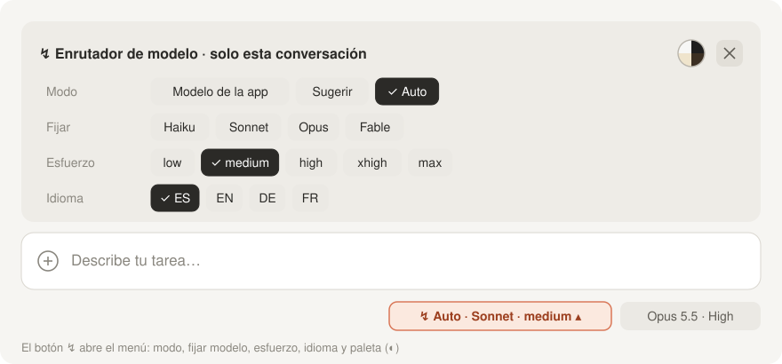
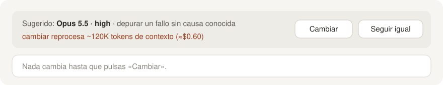
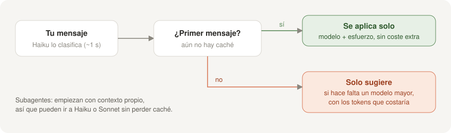

# model-router

[English](README.md) · **Español** · [Deutsch](README.de.md) · [Français](README.fr.md) · [Web](https://luispuertollano.github.io/claude-model-router/)

**El modelo y el esfuerzo de Claude adecuados para cada conversación, siguiendo la guía de Anthropic, sin reprocesar el contexto a tus espaldas.**



Casi todo el mundo usa el mismo modelo y el mismo esfuerzo para todo: paga de más en lo sencillo y se queda corto en lo difícil. Este plugin lo resuelve:

- **Claude Code: un botón `↯ Enrutador ▾` junto al selector de modelo.** Abre un menú encima del cuadro de texto: *Modo* (modelo de la app, *Sugerir*, *Auto*), *Fijar* Haiku, Sonnet, Opus o Fable, *Esfuerzo* (low → max) e *Idioma* (ES, EN, DE, FR). Cada conversación recuerda su modo; las nuevas empiezan apagadas.
- **Haiku clasifica tu mensaje** con las reglas de [*Which Claude model should you build with?*](https://claude.dev/blog/which-claude-model-should-you-build-with/) de Anthropic: Haiku para lo simple y repetitivo, Sonnet para lo acotado, Opus por defecto y Fable solo para lo ambicioso y abierto. El esfuerzo sale de cuatro preguntas: ¿ida y vuelta? `low` · ¿un error saldría caro? `high` · ¿trabajo largo y crítico? `xhigh` · si no, `medium`.
- **Sin gastos ocultos.** Cambiar de modelo a mitad de conversación reprocesa todo el contexto, porque la caché es de cada modelo. Por eso la mod solo cambia sola en el **primer mensaje**. Después **sugiere**, enseña los tokens que costaría y no cambia nada hasta que pulsas *Cambiar*.
- **Subagentes más baratos.** En *Auto*, Explore va a Haiku y los demás subagentes genéricos se clasifican, sin pasar nunca del modelo de la conversación.
- **Chat y Cowork: la skill `model-advisor`.** Te dice en una línea qué modelo y esfuerzo elegir, y escribe un traspaso a una conversación nueva cuando cambiar a mitad saldría caro. En Cowork, el subagente `haiku-reader` hace la lectura larga con Haiku (experimental: la documentación de Cowork aún no dice si respeta el modelo del subagente).





## Instalación

**Claude Code, terminal:**

```
/plugin install model-router --marketplace LuisPuertollano/claude-model-router
```

Responde `y` a *Add marketplace?*, elige el ámbito *user* con Enter y verás `Installed model-router. Plugin is now active.` Desde una consola:

```bash
claude plugin install model-router --marketplace LuisPuertollano/claude-model-router
```

**App de escritorio, Chat y Cowork:** pulsa **+** junto al cuadro de texto → **Plugins** → **Add marketplace** con `LuisPuertollano/claude-model-router` → **Add plugin**.

**Opcional, para que el asesor actúe solo en Chat y Cowork**, pega esto en claude.ai → Ajustes → Perfil → preferencias personales:

```
Al empezar cada tarea nueva, usa la skill model-advisor para decirme en una línea qué modelo de Claude y qué nivel de esfuerzo le van. Si cambiar a mitad de conversación reprocesaría un contexto largo, propón una conversación nueva con un traspaso.
```

## Uso (Claude Code)

| Control | Efecto (solo en esta conversación) |
| --- | --- |
| Modo: *Modelo de la app* | Apagado: se usa el modelo elegido en la app. |
| Modo: *Sugerir* | Muestra la sugerencia; nada cambia hasta que pulses *Cambiar*. |
| Modo: *Auto* | Elige en el primer mensaje; después solo sugiere subir, con su coste. |
| Fijar: *Opus…* | Fija ese modelo en esta conversación. |
| Esfuerzo: *low … max* | Cambia el esfuerzo; mismo modelo, así que no reprocesa. |
| Idioma: *ES · EN · DE · FR* | Idioma de la mod (todas las conversaciones). |
| `/modelo opus high` | Fija modelo y esfuerzo. |
| `/modelo libre` | Vuelve al modelo de la app. |
| `/modelo idioma es` | Cambia el idioma. |

Un punto (•) en el botón indica una sugerencia pendiente. El idioma de la mod parte del ajuste `language` de Claude Code.

## Coste

Cada mensaje que se clasifica cuesta una llamada corta a Haiku 5.5, una fracción de céntimo. Las respuestas cortas («sí», «hazlo») no se clasifican. Con el enrutador apagado no se hace ninguna llamada.

## Límites

- El botón y el menú solo existen en **Claude Code**. En el Chat y en Cowork nada puede cambiar el modelo de la conversación: ahí el plugin aconseja y tú cambias.
- El selector de modelo de la app no cambia de aspecto; el modelo que se usa es el que indica el botón del enrutador.
- La estimación de coste usa precios de lista; con una suscripción cuenta en tokens, no en dinero.
- Apagar el enrutador a mitad de conversación devuelve el modelo de la app, y eso también reprocesa el contexto. La mod avisa.

## Licencia

MIT
