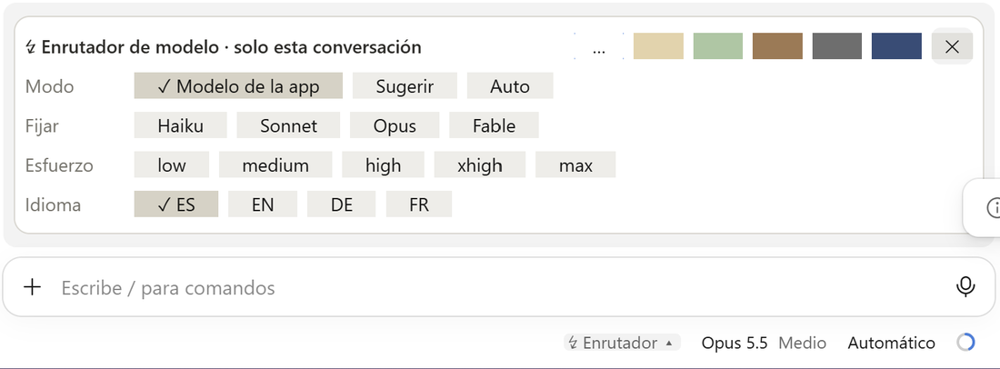
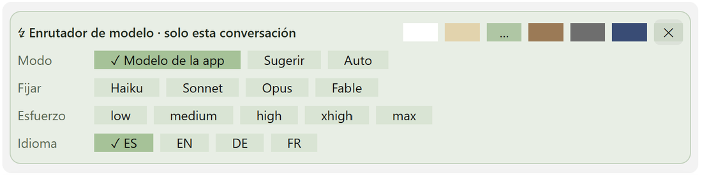
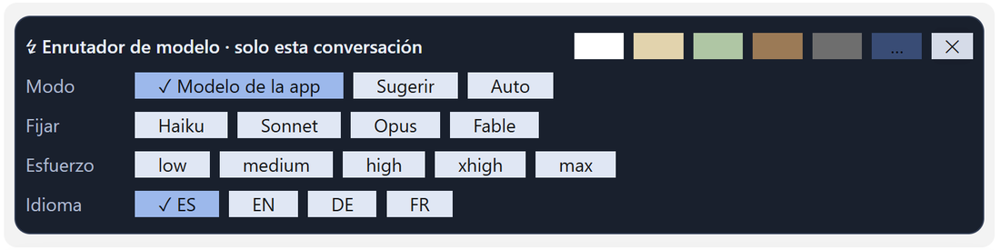
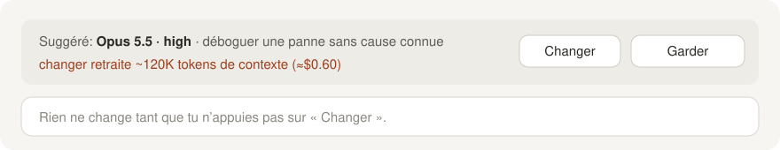
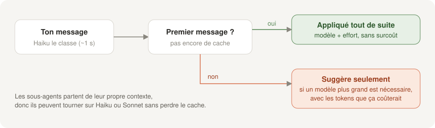

# model-router

[English](README.md) · [Español](README.es.md) · [Deutsch](README.de.md) · **Français** · [Site](https://luispuertollano.github.io/claude-model-router/)

**Le bon modèle Claude et le bon effort pour chaque conversation, selon le guide d’Anthropic, sans retraiter ton contexte dans ton dos.**



 

*Vraies captures de l’app de bureau (menu en espagnol) : couleurs de l’app, vert sauge et bleu nuit.*

La plupart des gens utilisent le même modèle et le même effort pour tout : ils paient trop pour le simple et manquent de puissance pour le difficile. Ce plugin règle ça :

- **Claude Code : un bouton `↯ Routeur ▾` près du sélecteur de modèle.** Il ouvre un menu au-dessus de la zone de saisie : *Mode* (modèle de l’app, *Suggérer*, *Auto*), *Fixer* Haiku, Sonnet, Opus ou Fable, *Effort* (low → max) et *Langue* (ES, EN, DE, FR). Chaque conversation retient son mode ; les nouvelles démarrent désactivées.
- **Haiku classe ton message** avec les règles de [*Which Claude model should you build with?*](https://claude.dev/blog/which-claude-model-should-you-build-with/) d’Anthropic : Haiku pour le simple et répétitif, Sonnet pour le cadré, Opus par défaut, Fable seulement pour le travail ambitieux et ouvert. L’effort découle de quatre questions : allers-retours ? `low` · erreur coûteuse ? `high` · long travail critique ? `xhigh` · sinon `medium`.
- **Pas de coûts cachés.** Changer de modèle en cours de conversation retraite tout le contexte, car le cache appartient à chaque modèle. Le mod ne change donc tout seul qu’au **premier message**. Ensuite il **suggère**, montre les tokens que ça coûterait et ne change rien tant que tu n’appuies pas sur *Changer*.
- **Sous-agents moins chers.** En *Auto*, Explore tourne sur Haiku et les autres sous-agents génériques sont classés, jamais au-dessus du modèle de la conversation.
- **Apprend tes objectifs.** Quand tu le corriges (tu fixes un autre modèle, ou tu choisis *Garder* quand il propose de changer au premier message), il garde le début du message et ton choix. Les 20 dernières corrections vont au classifieur comme exemples, et il les suit quand quelque chose de semblable arrive. Elles restent sur ton ordinateur ; `/modelo olvidar` ou le bouton *Oublier* les efface.
- **Montre ce que tu économises.** La ligne *Coût* du menu indique ce qu’a coûté cette conversation (classifieur compris) et ce qu’elle aurait coûté toujours avec Opus, aux prix publics.
- **Chat et Cowork : la skill `model-advisor`.** Elle te dit en une ligne quel modèle et quel effort choisir, et rédige un passage de relais vers une nouvelle conversation quand changer en cours coûterait cher. Dans Cowork, le sous-agent `haiku-reader` fait la lecture longue sur Haiku (expérimental : la doc de Cowork ne dit pas encore s’il respecte le modèle du sous-agent).





## Installation

**Claude Code, terminal :**

```
/plugin install model-router --marketplace LuisPuertollano/claude-model-router
```

Réponds `y` à *Add marketplace?*, choisis la portée *user* avec Entrée et tu verras `Installed model-router. Plugin is now active.` Depuis un shell :

```bash
claude plugin install model-router --marketplace LuisPuertollano/claude-model-router
```

**App de bureau, Chat et Cowork :** clique sur **+** à côté de la zone de saisie → **Plugins** → **Add marketplace** avec `LuisPuertollano/claude-model-router` → **Add plugin**.

**Optionnel, pour que le conseiller agisse de lui-même dans Chat et Cowork**, colle ceci dans claude.ai → Paramètres → Profil → préférences personnelles :

```
Au début de chaque nouvelle tâche, utilise la skill model-advisor pour me dire en une ligne quel modèle Claude et quel niveau d’effort conviennent. Si changer en cours de conversation retraitait un long contexte, propose plutôt une nouvelle conversation avec un passage de relais.
```

## Utilisation (Claude Code)

| Contrôle | Effet (cette conversation seulement) |
| --- | --- |
| Mode : *Modèle de l’app* | Désactivé : le modèle choisi dans l’app est utilisé. |
| Mode : *Suggérer* | Montre la suggestion ; rien ne change sans *Changer*. |
| Mode : *Auto* | Choisit au premier message ; ensuite ne suggère que de monter, avec le coût. |
| Fixer : *Opus…* | Fixe ce modèle dans cette conversation. |
| Effort : *low … max* | Change seulement l’effort. Avec un modèle choisi, il le garde (pas de retraitement) ; sans modèle, rien n’est fixé et l’effort s’applique au modèle de l’app. `/modelo high` fait de même. |
| Palette : ▭ ▭ ▭ ▭ ▭ ▭ (six pastilles à côté du titre) | Couleurs du seul menu du routeur, pas du reste de l’app : du plus clair au plus foncé : clair, crème clair, vert sauge, crème foncé, sombre ou bleu nuit. L’active porte un ✓ ; appuyer à nouveau revient aux couleurs de l’app. Vaut pour toutes les conversations. |
| Langue : *ES · EN · DE · FR* | Langue du mod (toutes les conversations). |
| `/modelo opus high` | Fixe modèle et effort. |
| `/modelo libre` | Revient au modèle de l’app. |
| `/modelo idioma fr` | Change la langue. |
| Ligne *Coût* | Coût de cette conversation face à toujours Opus, et de combien de tes décisions il apprend. |
| `/modelo olvidar` | Oublie tes décisions apprises (aussi le bouton *Oublier*). |

Un point (•) sur le bouton signale une suggestion en attente. La langue du mod part du réglage `language` de Claude Code.

L’arbre de décision complet, avec schémas : [DECISION-TREE.md](DECISION-TREE.md#français). Les modèles que ton compte ne peut pas utiliser (Fable, par exemple) sont détectés une fois et remplacés par le suivant en dessous.

## Coût

Chaque message classé coûte un court appel à Haiku 5.5, une fraction de centime. Les réponses courtes (« oui », « vas-y ») ne sont pas classées. Routeur désactivé, aucun appel.

## Limites

- Le bouton et le menu n’existent que dans **Claude Code**. Dans Chat et Cowork, rien ne peut changer le modèle de la conversation : le plugin conseille et c’est toi qui changes.
- Le sélecteur de modèle de l’app ne change pas d’aspect ; le modèle utilisé est celui qu’indique le bouton du routeur.
- L’estimation de coût utilise les prix catalogue ; avec un abonnement, ça compte en tokens, pas en argent.
- Désactiver le routeur en cours de conversation rétablit le modèle de l’app, ce qui retraite aussi le contexte. Le mod prévient.

## Licence

MIT
