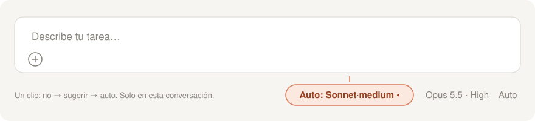
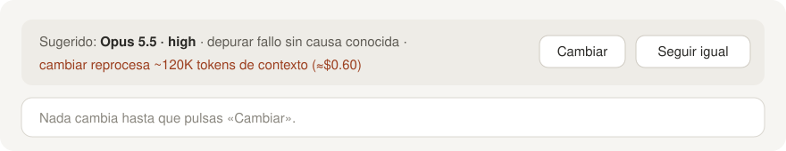
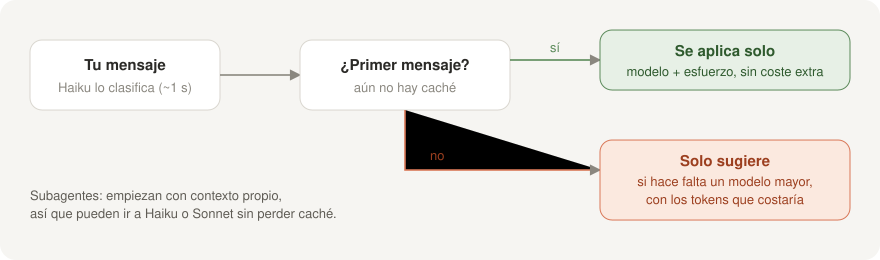

# model-router · Claude Code

**Elige el modelo y el esfuerzo de Claude para cada conversación, siguiendo la guía de Anthropic, sin reprocesar el contexto a tus espaldas.**

*English summary below.*



Casi todo el mundo usa el mismo modelo y el mismo esfuerzo para todo: paga de más en lo sencillo y se queda corto en lo difícil. `model-router` es una mod para Claude Code que lo hace por ti, conversación a conversación:

- **Un botón junto al selector de modelo** con tres estados: *no*, *sugerir* y *auto*. Cada conversación recuerda el suyo; las nuevas empiezan apagadas.
- **Haiku clasifica tu mensaje** con las reglas de la guía de Anthropic, [*Which Claude model should you build with?*](https://claude.dev/blog/which-claude-model-should-you-build-with/): Haiku para lo simple y repetitivo, Sonnet para lo acotado, Opus por defecto y Fable solo para lo ambicioso y abierto. El esfuerzo sale de cuatro preguntas: ¿ida y vuelta? `low` · ¿un error saldría caro? `high` · ¿trabajo largo y crítico? `xhigh` · si no, `medium`.
- **Sin gastos ocultos.** Cambiar de modelo a mitad de conversación obliga a reprocesar todo el contexto, porque la caché es de cada modelo. Por eso el cambio automático solo ocurre en el primer mensaje. Después solo **sugiere**, enseñando los tokens que costaría, y no cambia nada hasta que pulsas *Cambiar*.
- **Subagentes más baratos.** En modo *auto*, Explore va a Haiku y los demás subagentes genéricos se clasifican, sin pasar nunca del modelo de la conversación. Empiezan con contexto propio, así que no pierden caché.





## Instalación

En la línea de comandos de una sesión de Claude Code en el terminal:

```
/plugin install model-router --marketplace LuisPuertollano/claude-model-router
```

Responde `y` a *Add marketplace?*, elige el ámbito (*user* para todas tus sesiones) con Enter y verás `Installed model-router. Plugin is now active.`

Desde una consola:

```bash
claude plugin install model-router --marketplace LuisPuertollano/claude-model-router
```

En la app de escritorio (pestaña Code), donde `/plugin` no está disponible: pulsa **+** junto al cuadro de texto → **Plugins** → **Add marketplace** con `LuisPuertollano/claude-model-router` → **Add plugin**.

## Uso

| Dónde | Qué hace |
| --- | --- |
| Botón del pie: **Modelo auto: no** | Apagado en esta conversación: manda el modelo de la app. |
| **Modelo: sugerir** | Muestra la sugerencia; solo cambia si pulsas *Cambiar*. |
| **Auto: Sonnet·medium** | Elige en el primer mensaje; después solo sugiere subir, con su coste. |
| `/modelo opus high` | Fija modelo y esfuerzo en esta conversación. |
| `/modelo libre` | Vuelve al modelo de la app. |
| `/modelo` | Muestra el estado de la conversación. |

Un punto (•) en el botón indica que hay una sugerencia pendiente.

## Coste

Cada mensaje que se clasifica cuesta una llamada corta a Haiku 5.5, una fracción de céntimo. Las respuestas cortas («sí», «hazlo») no se clasifican. Con el enrutador apagado no se hace ninguna llamada.

## Límites

- Solo funciona en **Claude Code**: terminal y pestaña Code de la app de escritorio. No afecta al chat de claude.ai ni a Cowork.
- El selector de modelo de la app no cambia de aspecto. El modelo que se usa es el que indica el botón.
- La estimación de coste usa precios de lista; con una suscripción cuenta en tokens, no en dinero.
- Apagar el enrutador a mitad de conversación devuelve el modelo de la app, y eso también reprocesa el contexto. La mod avisa.

## English summary

`model-router` is a Claude Code mod that picks the model (Haiku, Sonnet, Opus, Fable) and effort level per conversation, following Anthropic's model-selection guide. A footer button next to the model picker toggles *off → suggest → auto* for the current conversation only. Auto-switching happens **only on the first message**, when there is no prompt cache to lose. After that it only suggests upgrades and shows how many context tokens a switch would re-process. Generic subagents are routed to cheaper models. Install with `/plugin install model-router --marketplace LuisPuertollano/claude-model-router`.

## Licencia

MIT
