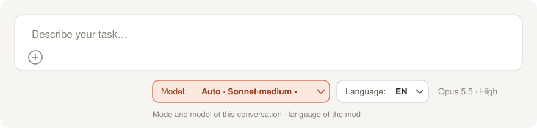
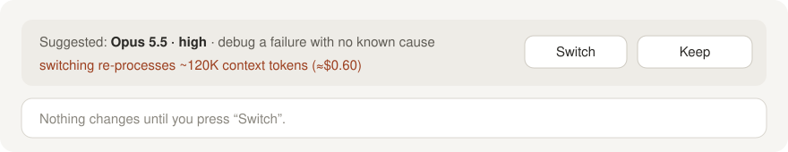
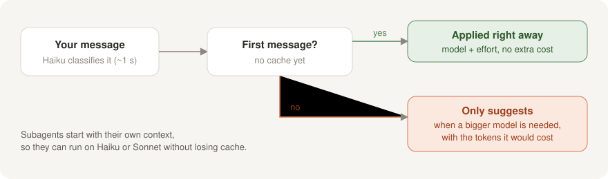

# model-router

**English** · [Español](README.es.md) · [Deutsch](README.de.md) · [Français](README.fr.md) · [Website](https://luispuertollano.github.io/claude-model-router/)

**The right Claude model and effort for each conversation, following Anthropic's guide, without re-processing your context behind your back.**



Most people run everything on the same model and effort: they overpay on simple work and fall short on hard work. This plugin fixes that:

- **Claude Code — a `↯ Router ▾` button next to the model picker.** It opens a menu above the prompt: *Mode* (the app's model, *Suggest*, *Auto*), *Pin* Haiku, Sonnet, Opus or Fable, *Effort* (low → max) and *Language* (ES, EN, DE, FR). Each conversation remembers its own mode; new ones start off.
- **Haiku classifies your message** with the rules of Anthropic's [*Which Claude model should you build with?*](https://claude.dev/blog/which-claude-model-should-you-build-with/): Haiku for simple and repetitive work, Sonnet for scoped tasks, Opus by default, Fable only for ambitious open-ended work. Effort comes from four questions: back-and-forth? `low` · costly mistake? `high` · long critical job? `xhigh` · otherwise `medium`.
- **No hidden costs.** Switching model mid-conversation re-processes the whole context, because the cache belongs to each model. So the mod only switches by itself on the **first message**. After that it **suggests**, shows the tokens a switch would cost, and changes nothing until you press *Switch*.
- **Cheaper subagents.** In *Auto*, Explore runs on Haiku and other generic subagents are classified, never above the conversation's model.
- **Claude chat and Cowork — the `model-advisor` skill.** It tells you in one line which model and effort to pick, and writes a handoff for a new conversation when switching mid-way would be expensive. In Cowork, the `haiku-reader` subagent does long reading on Haiku (experimental: Cowork's docs don't say yet whether it honors the subagent's model).





## Install

**Claude Code, terminal:**

```
/plugin install model-router --marketplace LuisPuertollano/claude-model-router
```

Answer `y` to *Add marketplace?*, choose the *user* scope with Enter, and you'll see `Installed model-router. Plugin is now active.` From a shell:

```bash
claude plugin install model-router --marketplace LuisPuertollano/claude-model-router
```

**Desktop app, Chat and Cowork:** click **+** next to the prompt box → **Plugins** → **Add marketplace** with `LuisPuertollano/claude-model-router` → **Add plugin**.

**Optional, to make the advisor proactive in Chat and Cowork**, paste this into claude.ai → Settings → Profile → personal preferences:

```
At the start of each new task, use the model-advisor skill to tell me in one line which Claude model and effort level fit it. If switching mid-conversation would re-process a long context, suggest a new conversation with a handoff instead.
```

## Use (Claude Code)

| Control | Effect (this conversation only) |
| --- | --- |
| Mode: *App's model* | Off: the model picked in the app is used. |
| Mode: *Suggest* | Shows the suggestion; nothing changes until you press *Switch*. |
| Mode: *Auto* | Picks on the first message; afterwards only suggests upgrades, with their cost. |
| Pin: *Opus…* | Pins that model in this conversation. |
| Effort: *low … max* | Sets the effort only. With a model chosen it keeps that model (no re-processing); with none it pins nothing and applies to the app's model. `/modelo high` does the same. |
| Palette: ▭ ▭ ▭ ▭ ▭ ▭ (six swatches beside the title) | Colours of the router's menu only, not the rest of the app: from lightest to darkest: light, light cream, sage green, dark cream, dark or night blue. The active one shows a ✓; press it again to go back to the app's colours. Applies to all conversations. |
| Language: *ES · EN · DE · FR* | Language of the mod (all conversations). |
| `/modelo opus high` | Pins model and effort. |
| `/modelo libre` | Back to the app's model. |
| `/modelo idioma de` | Changes the language. |

A dot (•) on the button means a suggestion is waiting. The mod's language starts from Claude Code's `language` setting.

The full decision tree, with diagrams: [DECISION-TREE.md](DECISION-TREE.md). Models your account cannot use (Fable, for instance) are detected once and replaced by the next one down.

## Cost

Each classified message costs one short Haiku 5.5 call, a fraction of a cent. Short replies ("yes", "do it") aren't classified. With the router off, no call is made.

## Limits

- The button and menu exist only in **Claude Code**. In Chat and Cowork nothing can change the conversation's model, so there the plugin advises and you switch.
- The app's model picker doesn't change its look; the model in use is the one the router's button shows.
- Cost estimates use list prices; on a subscription it counts in tokens, not money.
- Turning the router off mid-conversation brings back the app's model, which also re-processes the context. The mod warns you.

## License

MIT
